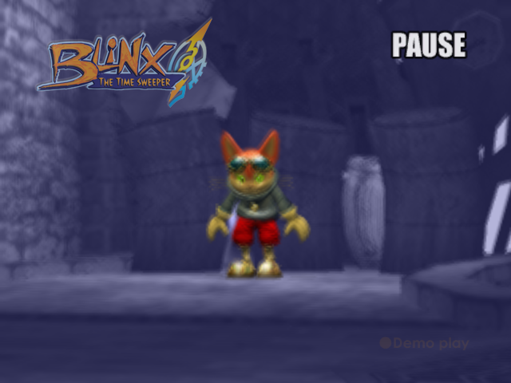
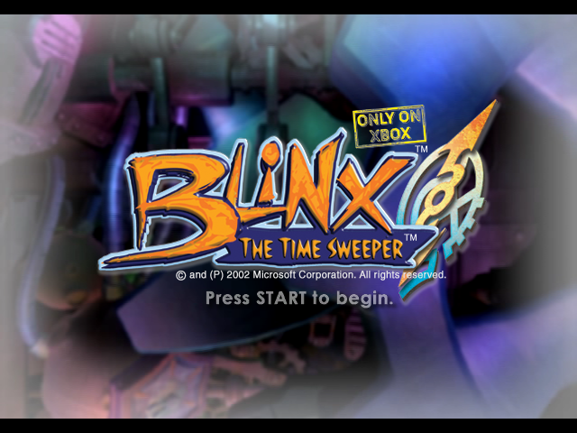
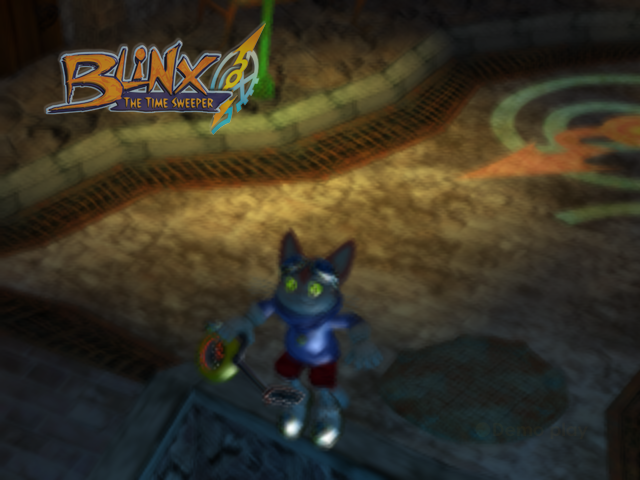
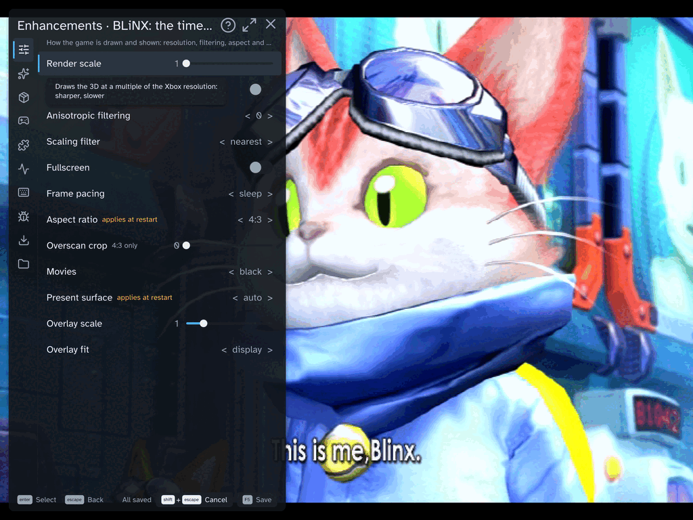
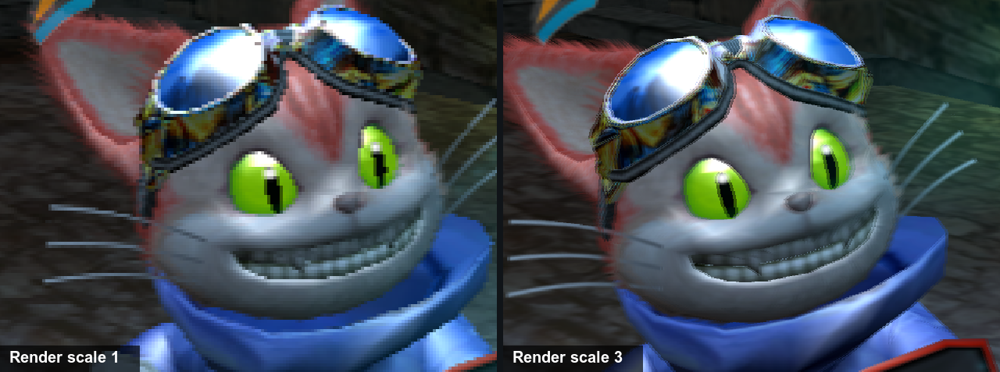
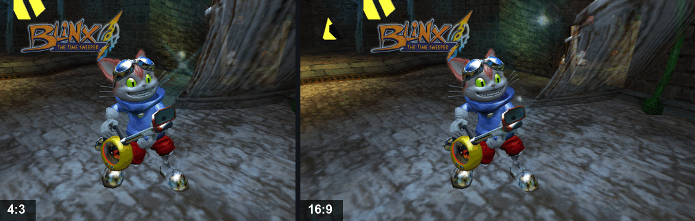
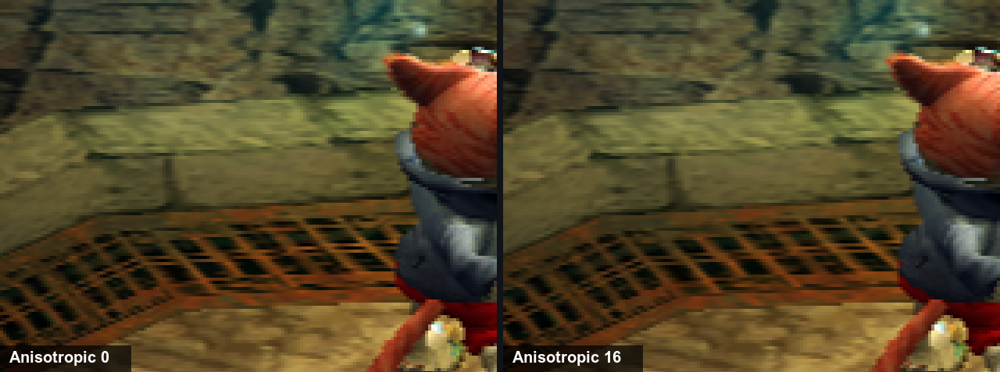
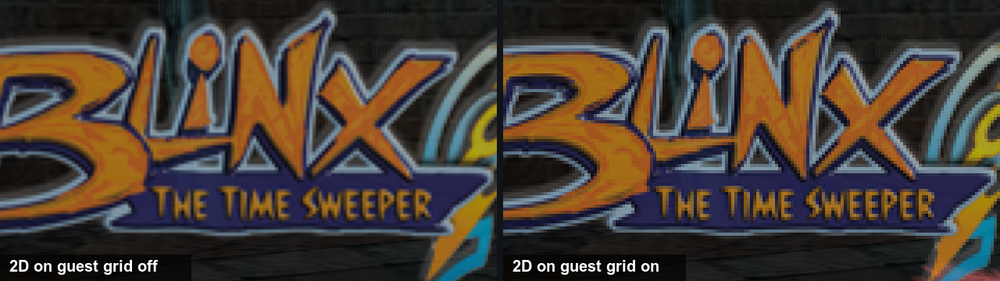
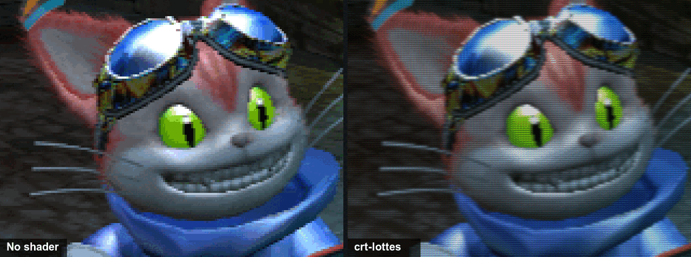
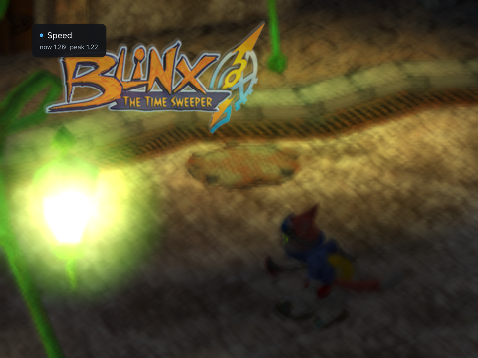

# BLiNX: the time sweeper

*BLiNX: the time sweeper* is a 2002 Xbox action game: you play Blinx, a cat
who sweeps up time glitches with a vacuum cleaner, and who can stop, slow,
rewind and record time. This project turns your own copy of the Xbox disc
into a game that runs on Windows, a Mac or a Steam Deck. No emulator, and
no disc in a drive once it is built.

<!-- xbr:readme:download -->
> [!TIP]
> **Get the builder:** download the wizard for your computer from the
> [latest release](https://github.com/apexJCL/blinx1-recomp/releases/latest),
> point it at your own disc image, and it builds and installs the game for you.
>
> | Your computer | Download |
> |---|---|
> | Windows 10 or 11 (x86-64) | `blinx1-wizard-<version>-windows-x64.zip` |
> | Mac (Apple silicon) | `blinx1-wizard-<version>-macos.zip` |
> | Steam Deck or Linux PC | `blinx1-wizard-<version>-linux-x64.tar.gz` |
<!-- /xbr:readme:download -->

**No game is included.** You need your own copy of BLiNX: the time
sweeper; everything the builder makes from it stays on your machines.

<!-- xbr:readme:release -->
> [!IMPORTANT]
> **Supported game version.** This port is built for one release of
> BLiNX: the time sweeper only:
>
> | | |
> |---|---|
> | Title | BLiNX: the time sweeper |
> | Title ID | `0x4D530013` |
> | Region | NTSC-U |
> | Version | 6 |
> | `default.xbe` sha256 | `771b8b6347d6f4348b79911210c1e17f7a1cd1fbfd3356d56bebee74f04bf745` |
>
> The wizard checks your copy on its Dump page before it builds; by hand,
> `./blinx1 fingerprint /path/to/your/disc.iso` says the same. Another
> region or version is **not supported**: it warns "another release", and
> the game may crash or misbehave. A modded copy warns too.
<!-- /xbr:readme:release -->

## How the builder works

<!-- xbr:readme:wizard -->
- Checks your computer and fetches the build tools it needs, each download
  checked against a known checksum. It sends nothing of yours.
- Checks your disc image or game folder, and says before building when it
  is another release or a modded copy.
- Builds an installer for this computer, or for another one: a Windows setup
  program, a Mac app (`.dmg`) or a Steam Deck bundle that adds the game to
  Steam.
- Lets you pick the basic options before building:
  - Render scale
  - Start fullscreen
- Makes small updates for a device that already has a build, and reuses
  most of the work when you build again.
<!-- /xbr:readme:wizard -->

Step by step, with the SmartScreen and Gatekeeper prompts, and the by-hand
route: [docs/playing.md](docs/playing.md#build-the-game).

## Status

**Early days.** The boot logos, the title screen and the attract demo run,
with sound, at 4:3 as on the Xbox. You can start
a game, but play past the title is not checked through the game yet:
expect crashes, and report them.

| You play on | Graphics | State |
|---|---|---|
| Windows 10 or 11 | Direct3D 11 | Boots to the title and the attract demo. |
| Steam Deck, Linux (Proton) | Direct3D 11 (DXVK) | Boots to the title and the attract demo. |
| Mac (Apple silicon) | Metal | Boots to the title and the attract demo; the screenshots here were taken on it. |

Top known issues (all of them: [docs/playing.md](docs/playing.md#known-issues)):

- Play past the title is not checked through the game yet.
- Widescreen is in, but not checked through the game either, so the
  default stays 4:3.

## Showcase

### The in-game menu

F10 on the keyboard (Guide+A, or Back+L3 held on a pad) opens a menu over
the game while it keeps running. Its pages: Render (scale, aspect,
filtering), Shaders, Mods, Stats, Controls, Saves and Files. Most settings
apply at once; Save keeps what you changed.

### Mods and enhancements

Every mod is off, or at the Xbox's setting, unless the table says
otherwise. Open the in-game menu, go to the page in the table and change
the option; most apply at once, and Save keeps them for the next start.
The wizard also asks for the render scale before it builds.

| Mod | Menu page | What it does | Default |
|---|---|---|---|
| **Render scale** | Render | Draws the 3D at 1 to 4 times the Xbox's 640x480: sharper, slower. | 1 |
| **Aspect ratio** | Render | Widescreen: 16:9, 16:10 or 21:9 show more of the stage at the sides instead of stretching it (from the next start). | 4:3 |
| **Anisotropic filtering** | Render | Sharper ground and walls seen at a slant: 2, 4, 8 or 16. | 0 |
| **Overscan crop** | Render | Crops the border an old TV hid, and zooms the rest (4:3 only). | 0 |
| **2D on guest grid** | Render | Keeps 2D art on the Xbox's pixel grid at render scale 2 and up, so tiled menus and HUD show no seams. | off |
| **Scaling filter** | Render | How the picture is stretched to the window: nearest is crisp, linear smooth, integer whole multiples only. | nearest |
| **Profile** | Shaders | A shader over the picture: crt-lottes, crt-lottes-fast or crt-hyllian for an old TV's look, fsr to upscale. | Off |
| **Draw distance** | Mods | Objects stay on screen further away instead of popping in at the game's cutoff: 1 to 4 times as far. | off (2x once on) |
| **Clamp diagonal speed** | Mods | Caps full diagonals (keyboard, or a pad with Square left stick) at straight speed, as in BLiNX 2. | off |
| **Speed readout** | Mods | Shows Blinx's run speed on screen: 1.00 straight, up to 1.69 on a full diagonal. | off |
| **Square left stick** | Controls | Maps a round stick to a square gate, so a pad's full diagonal runs 1.69x as fast as straight, as the keyboard's does. | on |

The pictures below come from the attract demo, run once per setting on a
Mac with Metal, so only the setting differs: the stock setting on the
left, the mod's on the right.

#### Render scale

The Xbox drew every game at 640x480. Render scale 3 draws the 3D at
1920x1440; the wizard asks for it, and Render > Render scale changes it
while you play.

#### Aspect ratio

Render > Aspect ratio > 16:9 keeps the game's height of view and shows
more of the stage at the sides. It takes effect at the next start, and is
not checked through the game yet.

#### Anisotropic filtering

Render > Anisotropic filtering > 16 keeps a texture sharp where it runs
away from the camera, as a floor does.

#### Overscan crop

A still shows only a zoom. Its origin: a TV of the time hid a band around
the picture, so console games kept their HUD away from the border, and
some left junk there. Overscan crop cuts that band and fills the window
with the rest. It works at 4:3 only.

#### 2D on guest grid

Above render scale 1 the 3D gets sharper, but 2D art made of tiles (menus,
the HUD, fonts) can show thin seams where the tiles meet, because each tile
now samples between the Xbox's pixels. This keeps 2D on the Xbox's own
pixel grid, as at scale 1: no seams, blockier 2D art.

#### Scaling filter

The Xbox drew for a TV; a window is larger, so the picture is stretched to
fit. Nearest keeps every pixel sharp, linear blends them for a softer
picture, and integer scales by whole multiples only, with a border, so
every pixel is the same size.

#### Profile

Shaders > Profile > crt-lottes draws the picture like an old TV, with
scanlines and a shadow mask; crt-hyllian is another look, and fsr is
AMD's upscaler instead. The Shaders page tunes each one, and saves a chain
of them as a profile of your own.

#### Draw distance

The game drops objects more than 400 units in front of the camera. At
480 lines that hid the pop-in; at render scale 2 and 3 the picture is
sharp enough to see things appear. Mods > Draw distance keeps them on
screen further out: twice the game's cutoff once it is on, up to four
times. It costs some speed.

<!-- TODO(screenshot): Mods > Draw distance, off and on, a stage with a long view -->
The attract demo's rooms all sit inside the game's cutoff, so a still of
it looks the same with the mod off and on; a picture waits for a stage
with a long view.

#### Clamp diagonal speed

No picture: it changes speed. BLiNX 1 runs full diagonals 1.69 times as
fast as straight, on the keyboard and on a pad with Square left stick (on
by default), because the game takes the speed from the stick's length and
a square's corner is longer than its side. BLiNX 2 capped that; this mod
caps it here too. One side effect: a diagonal tapped from the centre no longer counts
as shaking the stick.

#### Speed readout

A small card with Blinx's run speed: 1.00 at a full straight push, up to
1.69 on a full diagonal on the keyboard or a pad with Square left stick,
and the peak of about the last second. Outside a stage it shows the last
value. It was made to measure the mod above.

#### Square left stick

No picture: it changes the stick. On by default. The original Xbox pad's
stick moved in a square gate, so a diagonal reached the corner, and
BLiNX 1 ran it 1.69 times as fast. Today's pads have round gates and stop
short of the corner, so this maps a full push to the square's rim; drift
and smaller pushes keep their speed. To turn it off, open Controls >
Sticks and switch off Square left stick: diagonals then run at straight
speed on a round pad. Clamp diagonal speed caps every diagonal either
way.

## Build requirements and common gotchas

- About 15 GB free for the build, plus room for the installer.
- A Windows 10 or 11 PC, an Apple silicon Mac, or a Steam Deck or Linux PC
  (in Desktop Mode on the Deck).
- An internet connection for the first build (the tools download once).
- Your copy is the supported version (the box above).

The failures players hit most:

- **"Another release":** your disc is another region or revision than the
  NTSC-U, version 6 one. The build may stop at the very end, or the game
  misbehave; only the supported release is.
- **Mac: "the app is damaged" or cannot be opened:** that is Gatekeeper.
  Right-click the app and pick Open, once.
- **Steam Deck: the first launch shows only a notice for a few minutes:**
  it is downloading Proton; the notice closes when the game starts.

The rest: [docs/playing.md](docs/playing.md#troubleshooting).

## Report a bug

[Open a bug report](https://github.com/apexJCL/blinx1-recomp/issues/new?template=bug_report.yml):
the form asks for what we need (your game version, the build version, where
you play, your settings and the logs). Never attach game files, a disc
image, a save or a built bundle. Problems with the wizard or the `./blinx1`
commands themselves go to
[xboxrecomp-cli's issues](https://github.com/apexJCL/xboxrecomp-cli/issues).

## More documentation

| Document | For |
|---|---|
| [docs/playing.md](docs/playing.md) | building by hand, installing, the options, the in-game menu, known issues, troubleshooting |
| [docs/developers.md](docs/developers.md) | how the port works, building from source, the toolchain and its pins, contributing |

**Sister project.** [BLiNX 2: Masters of Time & Space](https://github.com/apexJCL/blinx2-recomp)
is recompiled with the same toolkit and build wizard, and is much further
along.

## Legal

This repository contains **no game data and no game code**: no game files,
assets or saves, and no lifted (recompiled) game code. `src/recomp/gen/` is
generated on your machine by the pipeline and is never committed.

To build it you need your own legally obtained copy of BLiNX: the time
sweeper. The game and its assets belong to their respective owners; this
project is not affiliated with them. A bundle made by `blinx1 package`
contains your copy of the game and code generated from it: it is for your
own machines only, and is not yours to redistribute.

### License and credits

MIT, see [LICENSE](LICENSE). Parts of `src/main.c`, `src/recomp_manual.c`
and `CMakeLists.txt` started from xboxrecomp's MIT-licensed new-game
templates; the license file carries that notice too. The toolkit that the
build links in statically carries LGPL-2.1 APU code extracted from xemu: if
you distribute a built binary, read [NOTICE](NOTICE) first.

Built on [xboxrecomp](https://github.com/sp00nznet/xboxrecomp) by sp00nz.
The pad layer and the in-game menu come from the BLiNX 2 project.
